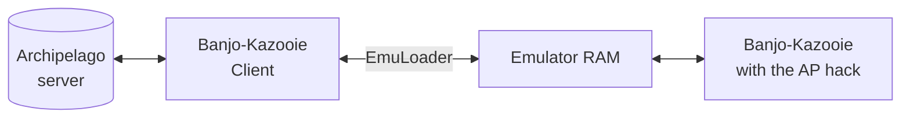

<p align="center">
  
</p>

<p align="center">
  <a href="https://github.com/kegan-dev/Archipelago-BanjoKazooie/releases"></a>
  <a href="https://archipelago.gg"></a>
  
  <a href="https://github.com/kegan-dev/Archipelago-BanjoKazooie/actions/workflows/tests.yml"></a>
  <a href="LICENSE"></a>
</p>

**Banjo-Kazooie for the [Archipelago](https://archipelago.gg) multiworld randomizer.** Every jiggy, Mumbo token,
empty honeycomb, Jinjo, Bottles' move and note door goes into the multiworld, and items from everyone else's games
come back into yours. The client makes the ROM you play from your own Banjo-Kazooie ROM and talks to the emulator
for you, the same way [Banjo-Tooie AP](https://github.com/jjjj12212/Archipelago-BanjoTooie) does.

> [!TIP]
> Want both games in one slot? [Banjo-Kazooie & Tooie](https://github.com/kegan-dev/Archipelago-BanjoKazooieTooie)
> puts Banjo-Kazooie behind the Lair's entrance in Banjo-Tooie's Spiral Mountain, on one ROM.

## What's in the pool

| Kind | Checks | Notes |
|---|---:|---|
| Jiggies | 100 | Picking one up is a check; the jiggies you can spend on puzzles come from the items you get |
| Mumbo tokens | 115 | Mumbo charges the tokens you've received |
| Bottles' moves | 20 | Each molehill is a check; moves come only as items (optional, `randomize_moves`) |
| Empty honeycombs | 24 | Your health follows the honeycombs you've received (optional, `randomize_honeycombs`) |
| Jinjos | 45 | One item per level and colour; a level's five give its Jinjo jiggy (optional, `randomize_jinjos`) |
| Note doors | 8 | A door opens when its item arrives; reaching its note count is a check |
| Notes | 900 | Every note is a check, and the doors count Notes received (optional, `notesanity`) |

The logic is [HarbourMasters' Lighthouse](https://github.com/HarbourMasters/Lighthouse) randomizer's, a rule for
every check, generated from its source. The goal is beating Gruntilda.

## Also in the box

- **No more grinding notes.** A note you pick up stays picked up, saved with your game.
- **Infinite lives.** A death never costs a life, so there's no game over.
- **Quick transform.** D-pad left changes Banjo into a world's form anywhere in it once you've paid Mumbo, and in the
  Lair right next to that world's door.
- **Shuffled world entrances** (`randomize_world_entrances`): each of the Lair's nine doors leads into a world drawn
  for your seed, and you leave the way you came in.
- **Death link, tag link and traps**: a trip, a slip, a squish, Mumbo's sparkle or one of Bottles' tips, each played
  once. Filler is egg and feather refills.
- **Skips**: the intro and the Lair's first cutscene (both on by default), and Start works on the opening logos.
- **Logic difficulty**: intended, easy tricks or hard tricks (`logic_type`).

## Playing

You need Archipelago 0.6.7 or newer, your own **Banjo-Kazooie (USA) v1.0** ROM (`.z64`, `.v64` or `.n64`), and
Project64 3.0.1 or ares v148.

1. Download `banjo_kazooie.apworld` and the template yaml from the
   [latest release](https://github.com/kegan-dev/Archipelago-BanjoKazooie/releases), and double-click the
   `.apworld` to install it.
2. Put your name in the yaml and give it to whoever is hosting.
3. Open the Archipelago Launcher and start the **Banjo-Kazooie Client**. The first time, it asks for your ROM and
   makes `Banjo-Kazooie AP <version>.z64` from it.
4. Connect to the server, open that ROM in your emulator, and start a new game on the file select.

The [setup guide](worlds/banjo_kazooie/docs/setup_en.md) has the details, and the [alpha guide](docs/ALPHA.md)
covers both worlds, what's different from the original game, and what to send when something breaks.

### Where it's been played

| | Status |
|---|---|
| Project64 3.0.1 (Windows) | Played through the alpha's tests |
| ares v148 (Windows) | Played through the alpha's tests |
| Other emulators, Everdrive, console | Not tried yet: reports welcome |

## How it works



The ROM is Banjo-Kazooie with an Archipelago hack, built from a fork of the
[Banjo-Kazooie decompilation](https://gitlab.com/banjo.decomp/banjo-kazooie). While it runs, it publishes an anchor
in the Expansion Pak's RAM: the address of a few small tables for the seed's settings, the items received and the
checks made. The client finds the anchor through [EmuLoader](https://github.com/Killklli/EmuLoader), writes what the
server sends, and sends back every check the game records. The game saves its checks with your file, so checks made
offline go out the next time you connect.

The apworld carries a patch with only the hack's changes, and the client applies it to your ROM. No game data is in
this repository or its releases.

## The Banjo repositories

| Repository | What it is |
|---|---|
| **Archipelago-BanjoKazooie** | This world and its client |
| [Archipelago-BanjoKazooieTooie](https://github.com/kegan-dev/Archipelago-BanjoKazooieTooie) | Both games in one slot: the combined world and its client |
| [AP-Banjo-Kazooie-Tooie](https://github.com/kegan-dev/AP-Banjo-Kazooie-Tooie) | The dual-boot image: both games on one cartridge image |
| [AP-Banjo-Kazooie](https://github.com/kegan-dev/AP-Banjo-Kazooie) | The Banjo-Kazooie ROM hack, a fork of the decompilation |
| [AP-Banjo-Tooie](https://github.com/kegan-dev/AP-Banjo-Tooie) | The Banjo-Tooie ROM hack, a fork of the Banjo-Tooie AP hack |

## Development

The world is in `worlds/banjo_kazooie/`. To run its tests, put it in an Archipelago checkout (Python 3.11 to 3.13):

```bash
git clone --branch 0.6.8 https://github.com/ArchipelagoMW/Archipelago.git
cd Archipelago
python -m venv .venv && .venv/bin/pip install -r ci-requirements.txt   # Windows: .venv\Scripts\pip
.venv/bin/python ModuleUpdate.py --yes
ln -s "$PWD/../Archipelago-BanjoKazooie/worlds/banjo_kazooie" worlds/banjo_kazooie   # Windows: mklink /J
.venv/bin/python -m pytest worlds/banjo_kazooie
```

The tests that need your retail ROM look for `Banjo-Kazooie (USA).z64` in a `roms/` folder at this repository's root
(git-ignored), or in the folder `BKBT_ROMS` names, and are skipped without it.

A few files are generated, so don't edit them by hand: `LogicData.py` and `Notes.py` come from Lighthouse and the
retail ROM, and `assets/` holds the patch built from the hack. The world's own logic changes go in `Rules.py`
(`OVERRIDES`), each with where it comes from.

Issues and pull requests are welcome. This repository is published from a development repository, so a merged pull
request lands there first and comes back here with the next release.

## Credits

- [jjjj12212, g0goTBC and Auztin](https://github.com/jjjj12212/Archipelago-BanjoTooie) for Banjo-Tooie AP, whose
  design this world copies: a ROM hack plus a client that writes into the emulator's RAM.
- The [Banjo-Kazooie decompilation](https://gitlab.com/banjo.decomp/banjo-kazooie) project, which the hack is built
  on.
- [HarbourMasters' Lighthouse](https://github.com/HarbourMasters/Lighthouse), for the randomizer logic (CC0).
- [CyrusKashef's BK_Randomizer](https://github.com/CyrusKashef/BK_Randomizer), for what it documents of the ROM.
- [Killklli's EmuLoader](https://github.com/Killklli/EmuLoader) (MIT), which the client reaches the emulator with;
  a copy ships in `worlds/banjo_kazooie/emu_loader/` with its licence.
- [Archipelago](https://archipelago.gg) and its community.

## Licence

[MIT](LICENSE), except EmuLoader's copy, which keeps its own MIT licence. Banjo-Kazooie is a trademark of its owners;
this project isn't affiliated with them. Bring your own legally obtained ROM.
